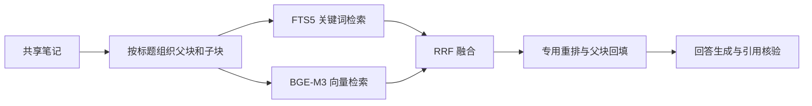

# Clone Me

Clone Me 是一个个人笔记知识库和 RAG 问答项目。你可以在后台编辑、管理和共享笔记。访客问答以共享笔记为依据，回答附带原文引用，证据不足时给出明确回应。

[线上站点](https://jujube.cyou/)

## 功能和技术栈

| 模块 | 实现 |
| --- | --- |
| 前端 | Vue 3、TypeScript、Vite、Tiptap。`atelier-ui-v1` 是线上使用的 PRISM 前端，包含访客页面和笔记管理后台。 |
| 服务端 | Java 25、Spring Boot 4、Spring AI 2、Spring Security、Spring JDBC 和 SQLite。 |
| 检索与生成 | SQLite FTS5/BM25、BGE-M3 向量召回、RRF 融合、BGE Reranker 和 DeepSeek Flash。 |
| 测试与部署 | Maven、Vitest、Playwright、GitHub Actions、Docker Compose 和 Nginx。 |



- 编辑原件保存在 SQLite 中，关键词索引和向量可以重建。异步更新索引时，在事务内校验笔记修订号和共享状态。
- 访客重复提交时，服务端可按会话和请求键返回已有结果。模型调用前预留预算，调用完成后按实际用量结算。
- 管理后台支持 TOTP 与恢复码。备份可校验文件完整性，并恢复到独立目录。

## 本地启动

请准备 JDK 25、Maven 3.9+ 和 Node.js 22.12+。以下命令在项目根目录的 Windows PowerShell 中执行。

```powershell
npm.cmd --prefix atelier-ui-v1 ci
npm.cmd --prefix atelier-ui-v1 run build
mvn.cmd -B -ntp -f backend/pom.xml -Patelier clean verify
if (-not (Test-Path -LiteralPath .env)) { Copy-Item .env.example .env }
.\scripts\dev.ps1 MasterKey
```

将命令生成的主密钥填入本地 `.env` 的 `CLONE_MASTER_KEY`，再填写 `CLONE_ADMIN_USERNAME` 和 `CLONE_ADMIN_PASSWORD`。管理员密码至少 12 个字符。初始化完成后，保存终端输出的 TOTP 注册信息和恢复码，并清除本地 `.env` 中用于初始化的明文密码。

```powershell
.\scripts\dev.ps1 InitAdmin
.\scripts\dev.ps1 Run
```

- 本地首页位于 `http://127.0.0.1:8080/`。
- 管理员登录位于 `http://127.0.0.1:8080/#/admin/login`。
- 访客问答使用 `.env.example` 中的 DeepSeek 配置。向量检索需要硅基流动 API Key。运行本地 UI 和自动化测试可以使用独立的测试数据。

## 验证和评测

```powershell
npm.cmd --prefix atelier-ui-v1 run check
Push-Location atelier-ui-v1
npx.cmd playwright install chromium
npm.cmd run test:e2e
Pop-Location
python scripts/evaluate.py --demo
```

离线演示使用虚构笔记。评测工具还可对同一份 SQLite 快照比较关键词检索、混合检索、混合检索加重排，用 Recall@30、MRR@5 和最终证据覆盖率查看各阶段的表现。真实模型评测需要显式启用并设置费用上限。

## 容器部署

`Dockerfile` 使用打包后的应用 JAR。`deploy/compose.yml` 提供应用、Nginx 和 Certbot 的部署配置，`deploy/.env.example` 列出生产环境变量。生产启动前应准备独立的数据目录和 HTTPS 入口，并离线初始化管理员。`scripts/deploy.sh`、`scripts/rollback.sh` 和 `scripts/restore.sh` 分别用于发布、版本回滚和备份恢复。
